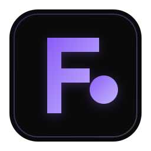

<div align="center">
  
  <h1>FOCULE</h1>
  <p><strong>Turn your old content into new social media content.</strong></p>
  <p>
    <a href="https://github.com/cotrk/focule-project/releases/tag/v1.1.1"></a>
    <a href="LICENSE"></a>
    
    
  </p>
  <p>
    <a href="https://github.com/cotrk/focule-project/releases/tag/v1.1.1"><strong>⬇ Download Focule 1.1.1</strong></a>
    &nbsp; · &nbsp;
    <a href="packaging/QUICKSTART.md">Installation guide</a>
    &nbsp; · &nbsp;
    <a href="packaging/licenses/THIRD-PARTY-NOTICES.md">Licenses</a>
  </p>
</div>

---

Focule is a free, local-first desktop app for turning videos and audio recordings
into searchable transcripts and ready-to-edit social content. Bring a video URL
or a file from your computer; Focule handles the media and transcription locally,
then asks a local Ollama model to draft hooks, descriptions, hashtags, keywords,
and thumbnail prompts.

<div align="center">
  <strong>VIDEO OR AUDIO</strong> &nbsp; → &nbsp;
  <strong>WHISPER TRANSCRIPT</strong> &nbsp; → &nbsp;
  <strong>SOCIAL CONTENT</strong>
</div>

## Why Focule?

| 🎬 Bring your content | ✍️ Get a useful first draft |
| --- | --- |
| Process supported YouTube and Twitch URLs, or local audio/video files. | Generate multiple hooks, descriptions, hashtags, keywords, and thumbnail prompts from the transcript. |
| 📼 **Keep it on your machine** | 🧰 **Your tools, your choice** |
| Transcription uses local Whisper; AI generation uses Ollama on `127.0.0.1:11434`. No cloud AI APIs or subscription service. | Start with the included Qwen 3.5 4B model, or select another compatible text-generation model already installed in Ollama. |

## Get started on Windows

**[Open the Focule 1.1.1 release page](https://github.com/cotrk/focule-project/releases/tag/v1.1.1)** and download the installer, the release-tools ZIP, both Qwen model parts, and `SHA256SUMS.txt`. The model is split into two files to fit GitHub's per-file upload limit.

1. Run `Focule-Setup-1.1.1.exe`.
2. Install and start [Ollama](https://ollama.com/download).
3. Extract `Focule-1.1.1-Release-Tools.zip` into the folder containing the two model parts and `SHA256SUMS.txt`.
4. Open PowerShell in that folder and join the model parts. The script verifies each part and the complete model before it writes the output:

   ```powershell
   powershell -ExecutionPolicy Bypass -File .\Join-QwenModelParts.ps1
   ```

5. Import the verified model into local Ollama:

   ```powershell
   powershell -ExecutionPolicy Bypass -File .\Install-QwenModel.ps1
   ```

6. Run `Setup-Whisper.ps1` if Python and Whisper are not already installed, then open Focule and start a project.

The installer includes FFmpeg, yt-dlp, and Whisper's `base` checkpoint. Ollama,
Python, and PyTorch are installed separately. Internet access is needed to obtain
the installer assets, install those prerequisites, or download source videos;
transcription and AI inference run locally.

> **Local means local inference.** Focule sends prompts and transcripts only to
> Ollama's local API at `http://127.0.0.1:11434/api/`. Downloading an online
> video still contacts its hosting service.

## What to expect

- The included Qwen 3.5 4B model is a lightweight starting point under the
  Apache 2.0 license. It needs about **3.4 GB** of disk space after import;
  generation quality and speed depend on your hardware and the chosen model.
- Whisper `base` is the bundled default. A 15-minute recording can be processed,
  but duration alone cannot guarantee a complete or accurate transcript.
- Silence, noisy or clipped audio, language, and recording quality can affect
  transcription. Focule reports common processing and generation errors and
  keeps a completed transcript if content generation fails.
- Focule transcribes speech in its spoken language; it **does not translate**.

## Built with

`React 18` · `TypeScript` · `Electron` · `Vite` · `Whisper` · `Ollama`

Focule source is MIT-licensed. Bundled tools, model, and checkpoint have their
own terms; see [third-party notices](packaging/licenses/THIRD-PARTY-NOTICES.md).

<div align="center">
  <sub>Made for creators who want to get more out of what they've already made.</sub>
</div>
